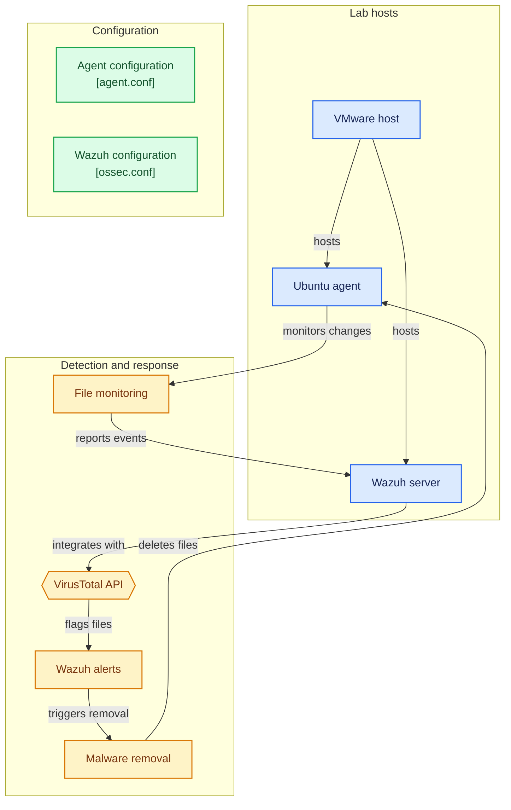

# Wazuh SIEM Homelab

This repository contains a simple SIEM homelab utilizing two ubuntu VMs (Wazuh server and agent), VirusTotal API, and a python script. The main goals of the SIEM are as follows:
- Understand the basics of configuring multiple Virtual Machines using VMware Workstation Pro
- Establish Wazuh's File Integrity Monitoring (FIM) features
- Utilize VirusTotal's real time malware detection
- Automatically delete files marked by VirusTotal through the use of a python script on the agent.

## Architecture



### Network

| Host | Description | Operating System | Processors | Storage | RAM | IP Address |
|---|---|---|---|---|---|---|
| Wazuh Server | Responsible for hosting the dashboard and managing/generating alerts | Ubuntu 26.04.1 LTS | 2 | 50GB | 4GB | 192.168.202.129 |
| Ubuntu Agent | The endpoint that is being monitored by the server | Ubuntu 26.04.1 LTS | 2 | 50GB | 4GB | 192.168.202.130 |

NOTE: All port numbers are set to their defaults and can be found on the [Wazuh Documentation Website](https://documentation.wazuh.com/current/getting-started/architecture.html)

---

## Components

| Component | Purpose | Version |
|---|---|---|
| Virtual Machine Software (VMware Workstation Pro) | hosting all of the VMs that are involved in the lab | 26H1 | 
| SIEM (Wazuh) | Visualization and logging | v.4.14.10 |
| Endpoint (Ubuntu Host) | Running the agent, collection of logs, execution of scripts | Ubuntu 26.04.1 LTS |
| Malware Scanner (VirusTotal API) | Detects malicious files, creates alerts for them | v3 |
| Active Response Automation (remove-threat.sh) *provided by Wazuh* | Automatically deletes malicious files detected by VirusTotal | / |
| Malware Tester (eicar) | File that sets off VirusTotal flags, allows for verifying whether or not VirusTotal API and Active Response are Operational | / |

---

## Configuration

### File Integrity Monitoring:
- Detects file creation, deletion and changes
- The Ubuntu agent was set up to detect changes in the entire endpoint system
  
### VirusTotal:
- Integrated into Wazuh allowing communication between VirusTotal and the Wazuh SIEM
- VirusTotal can identifies malicious contents which is then sent back to Wazuh so it can be displayed on the dashboard
- Alerts are used in Active Response Deletion

### Active Response:
- Through the utilization of the unmodified script found in Wazuh Documentation: [Detecting and removing malware using VirusTotal](https://documentation.wazuh.com/current/proof-of-concept-guide/detect-remove-malware-virustotal.html) the agent automatically deletes malicious files
- The script deletes files that are flagged by Wazuh through the use of VirusTotal API

---

## Testing

### Agent Connectivity with the VM
The simplest to make sure the Ubuntu agent is connected successfully is through the Wazuh dashboard on the upper left corner.


### VirusTotal Bad File Detection
Once the VirusTotal API is set up the command that is used to see if malicious files are being detected will be trying to download a non-malicious eicar file that will still flag the system. I downloaded the file to a folder named malware in tmp.

```bash
curl https://secure.eicar.org/eicar.com -o /tmp/malware/eicar
```

The command should generate the following results in the Wazuh:


### Active Response Testing
The same command is ran in the agent as the previous test, but the following results should generate instead:


---

## Learning Takeaways
This SIEM home lab introduces foundational cybersecurity concepts relevent to SOC analysts.

- Creating and understanding dashboards that organize data from multiple endpoints
- Integrating python scripts for preventing malware attempts and establishing active response
- Identifying threats using Wazuh
- Setting up Ubuntu VMs

---
  
## Future Improvements
- Add a windows endpoint to explore the use of multiple operating systems in one SIEM
- Add a Kali VM in order to generate real attacks to see how they appear in the log
- Add an allowlist with the goal of reducing false positives
