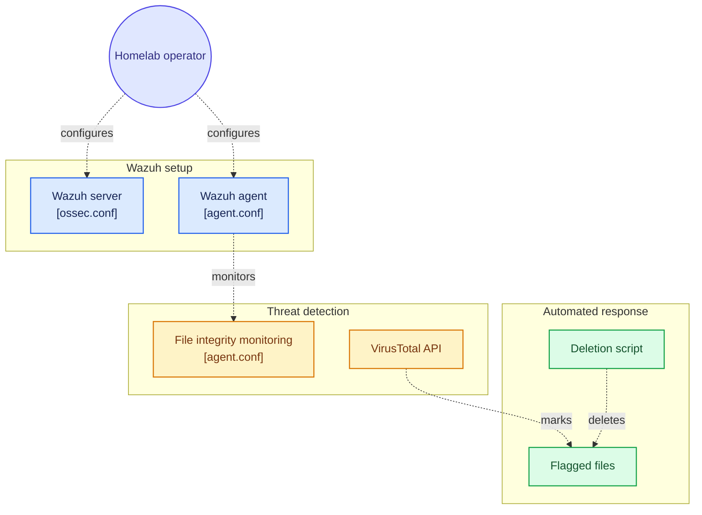

# Wazuh SIEM Homelab

This repository contains a simple SIEM homelab utilizing two ubuntu VMs (Wazuh server and agent), VirusTotal API, and a python script. The main goals of the SIEM are as follows:
- Understand the basics of configuring multiple Virtual Machines using VMware Workstation Pro
- Establish Wazuh's File Integrity Monitoring (FIM) features
- Utilize VirusTotal's real time malware detection
- Automatically delete files marked by VirusTotal through the use of a python script.

## Architecture

## Configuration

### File Integrity Monitoring:
- Detects file creation, deletion and changes
- The Ubuntu agent was set up to detect changes in the entire endpoint system
  
### VirusTotal:
- Integrated into Wazuh allowing communication between VirusTotal and the Wazuh SIEM
- VirusTotal can generate alerts based on the config rules
- Alerts are used in Active Response Deletion

### Active Response:
- Through the utilization of the unmodified script found in Wazuh Documentation: [Detecting and removing malware using VirusTotal](https://documentation.wazuh.com/current/proof-of-concept-guide/detect-remove-malware-virustotal.html) I was able to establish as system that deletes detected malicious files
- The script deletes files that are flagged by the VirusTotal API

## Learning Takeaways
This SIEM home lab introduces foundational cybersecurity concepts relevent to SOC analysts.

- Creating and understanding dashboards that organize data
- Integrating python scripts for preventing malware attempts and establishing active response
- Identifying threats using Wazuh
- Setting up Ubuntu VMs
  
## Future Improvements
- Add a windows endpoint to explore the use of multiple operating systems in one SIEM
- Add a Kali VM in order to generate real attacks to see how they appear in the log
- Add an allowlist with the goal of reducing false positives
