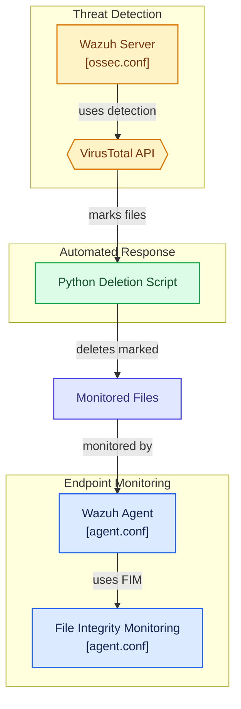

# Wazuh SIEM Homelab

This repository contains a simple SIEM homelab utilizing two ubuntu VMs (Wazuh server and agent), VirusTotal API, and a python script. The main goals of the SIEM are as follows:
- Understand the basics of configuring multiple Virtual Machines using VMware Workstation Pro
- Establish Wazuh's File Integrity Monitoring (FIM) features
- Utilize VirusTotal's real time malware detection
- Automatically delete files marked by VirusTotal through the use of a python script.

## Architecture

